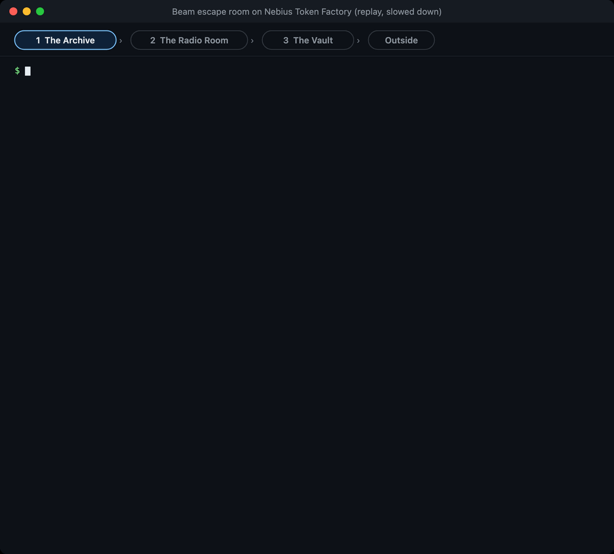
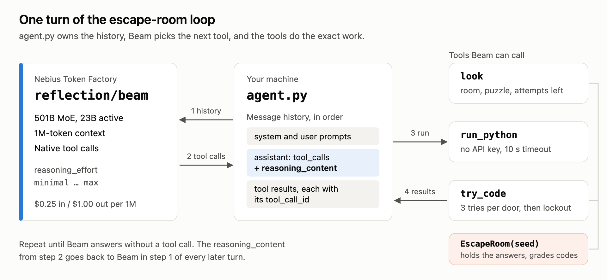
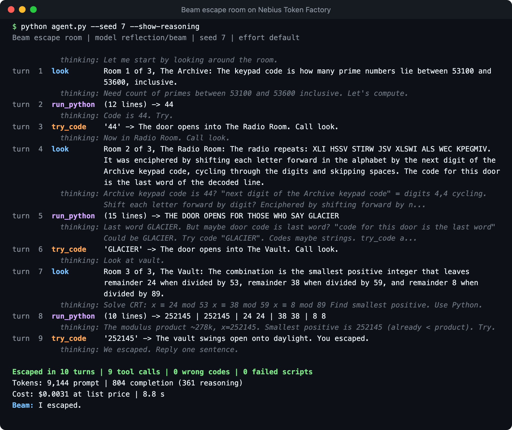
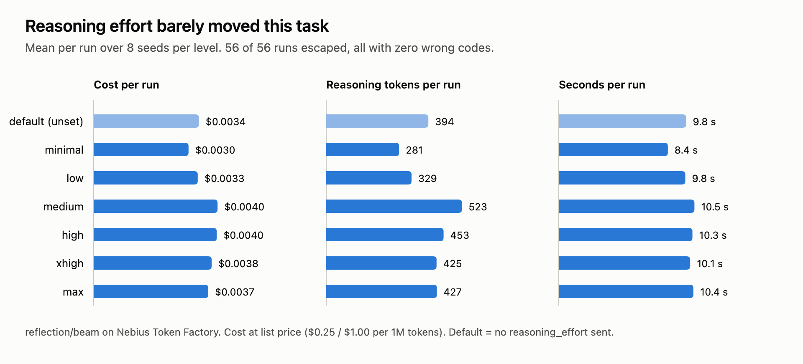

# Build a Python AI agent with Reflection AI's Beam

Beam is Reflection AI's first open-weight model, a 501B-parameter mixture-of-experts with 23B active parameters, built for coding and agentic work and released under Apache 2.0. Nebius Token Factory serves it as `reflection/beam` through the same OpenAI-compatible API as every other model in the catalog.

In this project you build an escape-room agent you can run on a laptop. You give Beam three tools and a seeded three-room game. Beam writes Python to crack each door, and you measure what each run costs.

Here is the game. Each room has a puzzle, and its answer is the code for the door:


And here is Beam playing it on Token Factory, replayed from a real run and slowed down so you can read along. The strip at the top shows which doors are open:



New to Beam? [Build with Beam on Token Factory](https://dev.nebius.com/cookbook/beam-reflection-token-factory) covers your first request and wiring Beam into a coding agent.

## What you will build

A command-line agent that:

- plays a deterministic three-room escape room built from a seed, so every run can be scored without a judge;
- gives Beam three tools: `look` to read the room, `run_python` to run a script in a child process, and `try_code` to enter a door code;
- runs the full tool-call loop, sending Beam's `reasoning_content` back on every turn;
- reads the live list price from the Token Factory catalog and prints what each run cost;
- sweeps every reasoning-effort level across several seeds so you can choose one with data, not guesswork.

## What's in this folder

| File | What it does |
|---|---|
| [`escape_room.py`](escape_room.py) | The seeded game, the three tool definitions, and the `run_python` sandbox |
| [`agent.py`](agent.py) | The tool-call loop against Token Factory, plus the command-line runner |
| [`sweep.py`](sweep.py) | Runs the game across effort levels and seeds, then prints a comparison table |
| [`tests/`](tests/) | Offline tests with a fake client: no key, no network |
| [`images/`](images/) | The illustrations and run snapshots in this README |

## How the loop works



Each room hides a code that is easy to compute and hard to guess:

1. **The Archive.** The keypad code is how many primes fall in a random five-digit range.
2. **The Radio Room.** A message is enciphered by shifting each letter by the digits of the Archive code. The last decoded word opens the door, so Beam has to carry an answer from one room into the next.
3. **The Vault.** The combination is the smallest positive integer with three given remainders modulo three primes.

Every door allows three attempts. The game, not the model, decides whether you escaped.

## Prerequisites

- Python 3.10 or newer and [uv](https://docs.astral.sh/uv/).
- A Token Factory API key with access to `reflection/beam`. See the [setup guide](../../start-here/setup.md) if you don't have one yet.
- About $0.004 per run, or about $0.20 for the full effort sweep.

Beam on Token Factory:

| Field | Value |
|---|---|
| Model ID | `reflection/beam` |
| Parameters | 501.3B total, 23.4B active |
| Context length | 1,048,576 tokens |
| Quantization | FP8 |
| Features | Tool calls, reasoning |
| Price | $0.25 per 1M input tokens, $1.00 per 1M output tokens |

`agent.py` reads the price from the catalog on every run, so its cost line stays correct if the price changes.

## Set up and test offline

```bash
git clone https://github.com/nebius/token-factory-cookbook.git
cd token-factory-cookbook/agents/beam-python-ai-agent
uv sync
uv run python -m pytest -q -p no:cacheprovider
```

The tests use a fake client that plays a perfect game, so they pass without a key and make no network calls. They check that each puzzle's answer is right, that three wrong codes lock you out, that the sandbox cannot see `NEBIUS_API_KEY`, and that the loop sends `reasoning_content` and the matching `tool_call_id` back to the model.

```text
........                                                                 [100%]
8 passed
```

## Run your first escape

Put your key in `.env`, then run seed 7 with Beam's reasoning shown:

```bash
cp env.example .env   # then put your key after NEBIUS_API_KEY=
set -a; source .env; set +a
uv run python agent.py --seed 7 --show-reasoning
```

`NEBIUS_BASE_URL` defaults to `https://api.tokenfactory.nebius.com/v1` and `NEBIUS_MODEL` to `reflection/beam`. Override either if you need to. Never commit `.env`; it is already in `.gitignore`.

The output looks like this:



In this run, Beam called `look`, wrote a 12-line prime counter, and entered `44`. It decoded the radio message with a second script and solved the remainder puzzle with a third. It escaped in 10 turns with no wrong codes: 9,144 prompt tokens, 804 completion tokens (361 of them reasoning), $0.0031, and 8.8 seconds. The italic `thinking:` lines are the start of each turn's `reasoning_content`.

Change `--seed` for new rooms, add `--effort low` (or any level from `minimal` to `max`) to set the reasoning effort, and add `--save run.json` to keep the run record.

## Walk through the code

### The sandbox

`run_python` starts a fresh interpreter for every script. The child gets an empty environment, a temporary working directory, and a 10-second timeout:

```python
def run_python(code: str, timeout: float = 10.0) -> dict:
    with tempfile.TemporaryDirectory() as workdir:
        try:
            done = subprocess.run(
                [sys.executable, "-I", "-"],
                input=code,
                cwd=workdir,
                env={},
                capture_output=True,
                text=True,
                timeout=timeout,
            )
        except subprocess.TimeoutExpired:
            return {"exit_code": None, "stdout": "", "stderr": f"Timed out after {timeout:g} seconds."}
    return {"exit_code": done.returncode, "stdout": done.stdout[-OUTPUT_LIMIT:], "stderr": done.stderr[-OUTPUT_LIMIT:]}
```

The empty environment keeps your API key out of the child's reach, and the timeout stops runaway loops. This is not a security boundary: the child can still reach the network and read your files. Before you point model-written code at anything you care about, run it in a container with networking off or in a disposable VM.

Errors come back as data, not exceptions, so Beam can read a traceback in `stderr` and fix its script on the next turn.

### The loop

Every turn sends the full history with the three tools, records token usage, and appends Beam's answer, reasoning included:

```python
choice = response.choices[0]
message = choice.message
reasoning = getattr(message, "reasoning_content", None)

# Beam needs its earlier reasoning back on later turns, so keep it in the history.
assistant = {"role": "assistant", "content": message.content or ""}
if reasoning:
    assistant["reasoning_content"] = reasoning
if message.tool_calls:
    assistant["tool_calls"] = [
        {"id": call.id, "type": "function", "function": {"name": call.function.name, "arguments": call.function.arguments}}
        for call in message.tool_calls
    ]
messages.append(assistant)

if not message.tool_calls:
    final = (message.content or "").strip()
    finish = "answered" if final else choice.finish_reason
    break

for call in message.tool_calls:
    result = call_tool(game, call.function.name, call.function.arguments)
    messages.append({"role": "tool", "tool_call_id": call.id, "content": result})
```

The loop builds the assistant message by hand, so the history carries exactly `content`, `tool_calls`, and `reasoning_content`. `call_tool` turns a tool name Beam was never given, or arguments that are not valid JSON, into an error result instead of an exception, so a stray call costs a turn instead of crashing the run.

`play()` stops after 24 turns (`--max-turns`), which bounds what a single run can cost, and it reads success from the game state rather than from Beam's final message.

The reasoning effort goes in `extra_body`, which sends the field exactly as written whatever your installed `openai` version's type hints list. When you omit `--effort`, the request leaves the field out and Beam uses its default.

### The price

The Token Factory models endpoint returns per-token pricing when you ask for the verbose listing:

```python
def list_prices(client: OpenAI, model: str) -> tuple[float, float] | None:
    for entry in client.models.list(extra_query={"verbose": "true"}):
        pricing = (entry.model_extra or {}).get("pricing")
        if entry.id == model and pricing:
            return float(pricing["prompt"]), float(pricing["completion"])
    return None
```

Cost is then prompt tokens times the input price plus completion tokens times the output price. Reasoning tokens are billed as output and are already inside `completion_tokens`.

## Choose a reasoning effort with data

Beam accepts `reasoning_effort` set to `minimal`, `low`, `medium`, `high`, `xhigh`, or `max`. `sweep.py` plays the same seeds at every level you list, four games at a time:

```bash
uv run python sweep.py --efforts default minimal low medium high xhigh max --seeds 1 2 3 4 5 6 7 8
```

`default` means the request carries no `reasoning_effort`. Across those 56 runs:



| Effort | Escaped | Wrong codes | Turns | Completion tokens | Reasoning tokens | Seconds | Cost per run |
|---|---:|---:|---:|---:|---:|---:|---:|
| default | 8/8 | 0 | 10.4 | 840 | 394 | 9.8 | $0.0034 |
| minimal | 8/8 | 0 | 10.1 | 757 | 281 | 8.4 | $0.0030 |
| low | 8/8 | 0 | 10.4 | 837 | 329 | 9.8 | $0.0033 |
| medium | 8/8 | 0 | 10.9 | 1,034 | 523 | 10.5 | $0.0040 |
| high | 8/8 | 0 | 10.5 | 1,021 | 453 | 10.3 | $0.0040 |
| xhigh | 8/8 | 0 | 10.5 | 971 | 425 | 10.1 | $0.0038 |
| max | 8/8 | 0 | 10.2 | 939 | 427 | 10.4 | $0.0037 |

Values are means per run. What the numbers say:

- **Effort barely matters when the tools do the hard part.** Every level escaped every seed without a wrong code. Beam's job here is to choose the right script, and Python does the arithmetic. `minimal` was the cheapest and fastest, but the whole spread is a tenth of a cent.
- **Higher effort does not mean more thinking on every turn.** Reasoning tokens peaked at `medium` rather than `max`. Beam scales its thinking to the problem, and a prime count does not need much.
- **Input dominates the bill.** A run averaged about 10,700 prompt tokens against under 1,100 completion tokens. Because the loop resends the growing history every turn, input is roughly three quarters of the cost even at a quarter of the output price. Trimming the history saves more than lowering the effort.

None of this says effort does not matter. On a task where the hard part happens inside the model, such as planning a refactor or debugging without a test runner, the levels will separate. Point `sweep.py` at a game that looks like your workload before you pick a default.

## Verify the result

You have a working setup when:

1. `uv run python -m pytest -q` reports `8 passed` without `NEBIUS_API_KEY` set.
2. `uv run python agent.py --seed 7` prints a line starting `Escaped in`, followed by a token count and a cost line in dollars.
3. Running it with `--save run.json` writes a record whose `escaped` field is `true` and whose `model` field is `reflection/beam`.
4. The requests show up under your project's usage in the Token Factory console.

## Troubleshooting

- **`401`.** The key is missing or wrong. Check that `.env` holds your key and that you ran `set -a; source .env; set +a` in the same shell.
- **`404` or model not found.** Check that `NEBIUS_MODEL` is unset or exactly `reflection/beam`, and that your key's project has access to it.
- **`Did not escape (..., max_turns)`.** The run hit the turn cap. Rerun with `--show-reasoning` to see where it stalled, or raise `--max-turns`.
- **`Did not escape (..., length)`.** A turn used its whole `max_tokens` budget before answering. Lower the effort or raise `max_tokens` in `play()`.

## Clean up

Nothing runs on Nebius after the script exits. Remove the local environment, the key file, and the variables from your shell:

```bash
rm -rf .venv .env
unset NEBIUS_API_KEY NEBIUS_BASE_URL NEBIUS_MODEL
```

## Going further

- **Build a harder room.** Add a function to `escape_room.py` that returns a `Room` with a computed answer, put it in the `rooms` list, and add a test that checks the answer independently. Rooms where the reasoning matters more than the arithmetic are where the effort levels will start to separate.
- **Swap in a real sandbox.** Replace the body of `run_python` with a call to a container or a hosted sandbox. Nothing else in the loop changes.
- **Try Reflection's harness.** Beam was trained alongside Mirror, Reflection's open-source terminal coding agent. Its [models and providers page](https://developers.reflection.ai/mirror-models) shows how to point it at any Chat Completions endpoint, which includes Token Factory.
- **Run the weights yourself.** The [Beam collection on Hugging Face](https://huggingface.co/collections/reflection/beam-10) has BF16, FP8, and NVFP4 checkpoints and a speculative-decoding drafter, if you want to serve Beam on your own Nebius AI Cloud GPUs.
